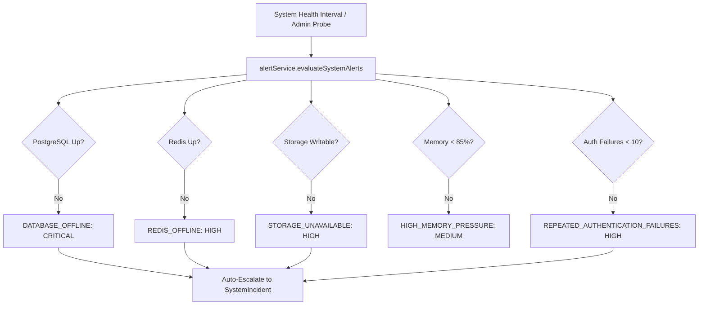

# Automated Alert Configuration & Operational Runbook – Collage Story

**Author:** Senior DevOps & Reliability Engineer  
**Platform:** Collage Story  
**Date:** November 25, 2026  
**Target Environment:** Production Infrastructure  

---

## 1. Alerting Rules & Threshold Configurations

Collage Story enforces operational alert rules evaluated dynamically by `alertService.js`:

### Configured Operational Thresholds

| Alert Rule Name | Target Component | Threshold / Condition | Severity | Cool-Off Window |
| :--- | :--- | :--- | :--- | :--- |
| `DATABASE_OFFLINE` | PostgreSQL 17 | Connection ping fails or pool exhausted | **CRITICAL** | 15 Minutes |
| `REDIS_OFFLINE` | Redis 7 | PING fails or socket disconnected | **HIGH** | 15 Minutes |
| `STORAGE_UNAVAILABLE` | Local File Vaults | Probe write fails on photos, thumbnails, discovery, or docs | **HIGH** | 15 Minutes |
| `HIGH_MEMORY_PRESSURE` | Host Server | Host RAM utilization >= 85% | **MEDIUM** | 15 Minutes |
| `REPEATED_AUTHENTICATION_FAILURES` | Auth Service | >= 10 login failures in trailing 5 minutes (Brute-force) | **HIGH** | 15 Minutes |
| `HIGH_ERROR_RATE` | API Server | >= 5.0% 5xx errors across total requests in 5 minutes | **HIGH** | 15 Minutes |

---

## 2. Deduplication & Anti-Storm Safeguards

To prevent cascading alert storms during degraded network conditions:
- **Deduplication Key:** Each rule combines rule name and component (`${alert.rule}_${alert.component}`).
- **In-Memory Cooldown:** Consecutive triggers within the 15-minute cool-off window are suppressed from creating duplicate incidents.
- **Incident Idempotency:** An existing unclosed incident for the same component prevents duplicate ticket generation.

---

## 3. Operational Runbook & Mitigation Guides

### Runbook 1: `DATABASE_OFFLINE`
1. Check Docker container status: `docker ps | findstr college-postgres`.
2. Inspect PostgreSQL log outputs for disk full or connection exhaustion.
3. Verify database port 5432 is open and listening.
4. Restart PostgreSQL container: `docker restart college-postgres`.
5. Run `GET /api/v1/admin/monitoring/health` to confirm latency is < 15ms.

### Runbook 2: `REDIS_OFFLINE`
1. Check Redis process: `docker ps | findstr college-redis`.
2. Confirm fallback to in-memory cache mode is active so user chat is not interrupted.
3. Restart Redis container: `docker restart college-redis`.
4. Verify reconnection in backend logs: `[INFO] Connected to Redis on 127.0.0.1:6379`.

### Runbook 3: `STORAGE_UNAVAILABLE`
1. Verify disk space on volume hosting `backend/storage`.
2. Inspect directory permissions on `photos`, `thumbnails`, `discovery`, and `documents`.
3. If permissions were revoked by OS update, run: `attrib -r /s backend\storage\*`.
4. Trigger manual probe via `GET /api/v1/admin/monitoring/health`.

### Runbook 4: `REPEATED_AUTHENTICATION_FAILURES`
1. Check `SystemErrorLog` where `category = 'LOGIN_FAILURE'` to identify source IP address.
2. If single IP is flooding, configure rate limiting or firewall drop.
3. Check whether legitimate students are locked out and assist via Admin Dashboard.
