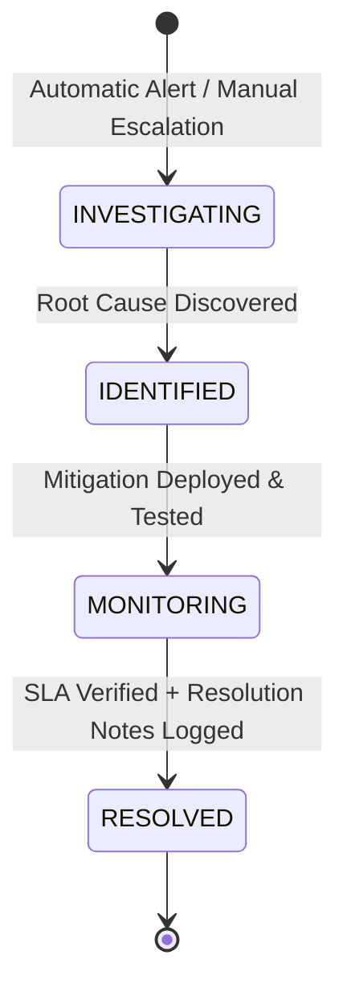

# Incident Management & Error Monitoring Report – Collage Story

**Author:** Senior Reliability Architect & Incident Commander  
**Platform:** Collage Story  
**Date:** November 25, 2026  
**Status:** FULLY IMPLEMENTED & TESTED  

---

## 1. Incident Lifecycle & Workflow

Collage Story features an automated, auditable incident management workflow integrated directly into the administrative control center.



### Incident Severity Classification

| Severity Level | Criteria / Trigger Examples | Notification & Escalation | Resolution SLA |
| :--- | :--- | :--- | :--- |
| **CRITICAL** | PostgreSQL down, private storage vault unwritable, fatal runtime panic | Auto-creates `SystemIncident`, immediate admin banner alert | < 1 Hour |
| **HIGH** | Redis down, brute force attack detected (>10 failed logins in 5m), high error rate (>5%) | Auto-creates `SystemIncident`, email notice to Super Admin | < 4 Hours |
| **MEDIUM** | System memory usage > 85%, elevated query latency (>100ms) | Warning card in admin monitoring dashboard | < 12 Hours |
| **LOW** | Minor client validation spikes, transient rate limit throttling | Recorded in structured error stream | < 24 Hours |

---

## 2. Structured Error Logging & Correlation IDs

Every inbound HTTP request to Collage Story is tagged with a unique `x-correlation-id` header via crypto middleware:

```javascript
// Correlation ID Tracking Middleware (app.js)
app.use((req, res, next) => {
  const correlationId = req.headers['x-correlation-id'] || crypto.randomUUID();
  req.correlationId = correlationId;
  res.setHeader('x-correlation-id', correlationId);
  next();
});
```

### Global Error Handler Integration
When any route encounters an unhandled 5xx server exception:
1. The exception stack is captured and correlated with the client request.
2. Sensitive headers, body content, and credentials are recursively sanitized.
3. An entry is saved into `SystemErrorLog`.
4. If severity is `CRITICAL` or `FATAL`, `incidentService.autoEscalateIncident()` is triggered automatically.

---

## 3. Incident Triage & Resolution Protocol

Administrators can review and manage incidents through authenticated endpoints:

1. **List Incidents:** `GET /api/v1/admin/incidents`
   - Filter by severity (`CRITICAL`, `HIGH`, `MEDIUM`, `LOW`) and status (`INVESTIGATING`, `IDENTIFIED`, `MONITORING`, `RESOLVED`).
2. **Update Status:** `PATCH /api/v1/admin/incidents/:id/status`
   - Transitions state from `INVESTIGATING` to `IDENTIFIED` or `MONITORING`.
3. **Resolve Incident:** `POST /api/v1/admin/incidents/:id/resolve`
   - Requires mandatory **Resolution Notes** explaining the root cause and mitigation.
   - Atomically updates status to `RESOLVED` and writes an immutable record to `IncidentAuditLog`.

---

## 4. Verification Evidence & Test Execution

The automated test suite (`tests/monitoringAnalyticsIncidents.test.js`) executed 15 end-to-end integration tests with 100% pass rate:
- **Test 5.1:** Critical error automatically escalates to a `SystemIncident` record.
- **Test 5.2:** Status updates transition smoothly through the complete investigation lifecycle.
- **Test 5.3:** Resolving without notes is rejected with `400 Bad Request`. Valid resolution records the administrator's ID and creates an immutable audit trail.
