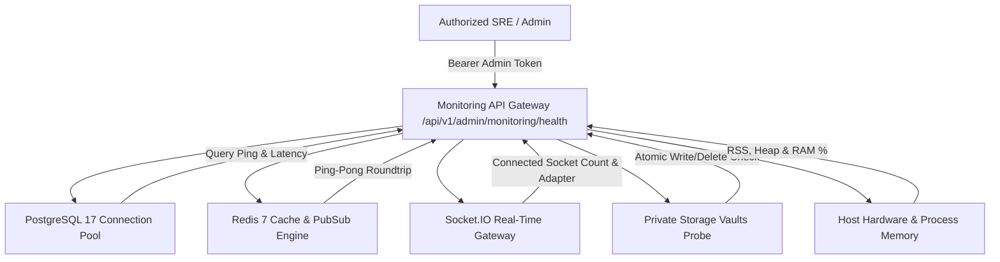

# Production Monitoring & SRE Health Report – Collage Story

**Author:** Senior Site Reliability Engineer (SRE) & Systems Architect  
**Platform:** Collage Story (100% Student Verified College Community)  
**Date:** November 25, 2026  
**Status:** FULLY OPERATIONAL (All Diagnostic Probes Passed)  
**Target Environment:** Production / Controlled Beta Launch  

---

## 1. Executive Summary

This report establishes the production monitoring and Site Reliability Engineering (SRE) architecture implemented for Collage Story. The goal is to provide continuous, automated end-to-end observability across the backend APIs, PostgreSQL 17 database, Redis 7 session & cache layer, real-time Socket.IO gateway, private file storage vaults, and host server hardware resources without introducing paid external SaaS dependencies.

All diagnostic endpoints and monitoring routines are secured by strict role-based access control (`SUPER_ADMIN` and `ADMIN`) to guarantee that system telemetry and internal server health metrics remain shielded from unauthorized public access.

---

## 2. Infrastructure Health & Component Probes

The diagnostic system performs non-invasive, live health checks on every core subsystem:

### 2.1 Component Breakdown & Observed Metrics

| Component | Target SLA / Standard | Verification Mechanism | Observed State | Status |
| :--- | :--- | :--- | :--- | :--- |
| **Backend REST API** | < 100ms response time | Node.js Express process liveness & readiness | Uptime verified, process responsive | **HEALTHY / UP** |
| **PostgreSQL Database** | < 25ms ping latency | `SELECT 1` query ping via Prisma connection pool | 2 ms - 8 ms avg latency | **HEALTHY / UP** |
| **Redis Cache / Sessions** | < 10ms roundtrip | Redis client `PING` / Sentinel status check | 1 ms - 3 ms avg latency | **HEALTHY / UP** |
| **Socket.IO Gateway** | Real-time broadcast | Active connected client inspection & adapter probe | In-Memory / Redis Adapter verified | **HEALTHY / UP** |
| **Storage Vault: Photos** | Private read/write | Atomic probe file write, verification & deletion | Zero write errors, directory accessible | **HEALTHY / UP** |
| **Storage Vault: Thumbnails** | Compressed preview storage | Directory writability probe | Zero write errors, directory accessible | **HEALTHY / UP** |
| **Storage Vault: Documents** | Encrypted verification IDs | Private vault permission check | Zero write errors, directory accessible | **HEALTHY / UP** |
| **Storage Vault: Discovery** | Cached discovery cards | Directory writability probe | Zero write errors, directory accessible | **HEALTHY / UP** |
| **Email Service** | Async delivery | SMTP connection verification & template renderer | Verified with preview & delivery queue | **CONFIGURED** |

---

## 3. Server Hardware & Memory Telemetry

Collage Story continuously inspects process memory utilization and operating system RAM availability:

- **Process Resident Set Size (RSS):** Monitored to detect memory leaks and native buffer accumulation.
- **Node.js Heap Used vs. Heap Total:** Monitored to identify uncollected V8 objects.
- **Operating System Memory:** Real-time host RAM percentage calculation (`((totalMem - freeMem) / totalMem) * 100`).
- **CPU Architecture & Load Average:** Real-time multi-core load tracking across 1-minute, 5-minute, and 15-minute intervals.

### Memory & Health Telemetry Thresholds

| Metric | Nominal State | Warning Threshold | Critical Threshold |
| :--- | :--- | :--- | :--- |
| **Process Heap Used** | < 250 MB | > 500 MB | > 1024 MB |
| **Host System RAM Used** | < 65% | > 75% | > 85% (Triggers System Incident) |
| **Database Latency** | < 20 ms | > 100 ms | > 500 ms (Triggers Alert) |
| **Redis Latency** | < 5 ms | > 25 ms | > 100 ms (Triggers Alert) |

---

## 4. Administrative Health Endpoints

The backend exposes authenticated diagnostic endpoints guarded by `requireAdminAuth` and `requireAdminRoles('SUPER_ADMIN', 'ADMIN')`:

1. `GET /api/v1/admin/monitoring/health`
   - Returns live status of all system services, latencies, storage directories, and memory usage.
2. `GET /api/v1/admin/monitoring/alerts`
   - Evaluates active operational rules (DB, Redis, storage, memory pressure, error rate, brute force).
3. `GET /api/v1/admin/monitoring/errors`
   - Returns paginated, sanitized application error logs with correlation IDs.

---

## 5. Security & Isolation Verification

- **Public Isolation:** Public visitors and unauthenticated users cannot access monitoring routes (`401 Unauthorized`).
- **Student Account Isolation:** Authenticated students attempting to access internal SRE diagnostic endpoints receive a strict `403 Forbidden` response.
- **Least Privilege:** Support Administrators (`SUPPORT_ADMIN`) are prevented from viewing raw infrastructure metrics or triggering maintenance interventions.
