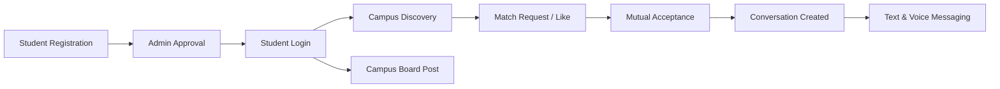

# Product Analytics & User Engagement Report – Collage Story

**Author:** Senior Product Analytics Engineer & Backend Architect  
**Platform:** Collage Story  
**Date:** November 25, 2026  
**Timezone Standard:** Asia/Kolkata (UTC+05:30)  
**Status:** OPERATIONAL  

---

## 1. Analytics Architecture & Privacy Standards

Collage Story implements a privacy-first, zero-knowledge product analytics system. Unlike invasive third-party tracking scripts, our analytics engine is built natively into PostgreSQL via Prisma, ensuring complete student data sovereignty.

### Strict Privacy Principles:
1. **Zero Content Tracking:** Private chat messages, audio recordings, personal documents, and passwords are strictly stripped before event storage.
2. **Deterministic Redaction:** A recursive sanitization engine replaces any field matching sensitive tokens (`password`, `token`, `secret`, `content`, `body`, `voiceDuration`, `document`) with `[REDACTED]`.
3. **Non-Blocking Execution:** Event recording runs asynchronously. If an analytics write fails, the student's request is never interrupted or delayed.
4. **Asia/Kolkata Calendar Boundaries:** All Daily Active Users (DAU), Weekly Active Users (WAU), and Monthly Active Users (MAU) metrics are aggregated using strict Asia/Kolkata midnight-to-midnight timestamps.

---

## 2. Essential Platform Events Tracked

The system tracks 11 key lifecycle events in the `AnalyticsEvent` PostgreSQL table:

| Event Type | Trigger Point | Tracked Metadata | Privacy Guard |
| :--- | :--- | :--- | :--- |
| `REGISTRATION_COMPLETED` | Step 6 submission | `applicationId`, college name | Personal photos/docs omitted |
| `APPLICATION_APPROVED` | Admin review completion | `applicationId`, approving admin ID | Passwords/keys omitted |
| `LOGIN_SUCCESSFUL` | Credential verification | Login IP, verified college name | Password omitted |
| `PROFILE_COMPLETED` | Profile setup completion | Preferred distance, college name | Private contact info omitted |
| `DISCOVERY_OPENED` | Student views deck | Verified college association | Partner identity omitted |
| `LIKE_SENT` | Match request dispatch | Target student ID, college name | Profile content omitted |
| `MATCH_ACCEPTED` | Mutual match confirmation | Match ID, partner ID | Chat text omitted |
| `CONVERSATION_STARTED` | First message thread | Conversation ID, college name | Message text omitted |
| `MESSAGE_SENT` | Text message sent | Conversation ID, character range | Message content omitted |
| `VOICE_MESSAGE_SENT` | Audio voice note sent | Conversation ID, duration seconds | Audio recording omitted |
| `POST_CREATED` | Campus Board broadcast | Post ID, post type, college name | Attachment bytes omitted |

---

## 3. Database Aggregation & Metric Definitions

All metrics presented on the Admin Analytics Dashboard reflect real database calculations:

- **Total Registered Students:** Real count of all student accounts in `User` and `PendingRegistration`.
- **Total Approved Students:** Exact count of active accounts with `verificationStatus = 'APPROVED'`.
- **Pending Applications:** Exact count of applicants waiting in `PENDING_REVIEW` queue.
- **Daily Active Users (DAU):** Distinct verified students who initiated an active session or performed an action within today's Asia/Kolkata boundary.
- **Weekly Active Users (WAU):** Distinct active students over the trailing 7 days.
- **Monthly Active Users (MAU):** Distinct active students over the trailing 30 days.
- **DAU / MAU Stickiness Ratio:** Standard SaaS engagement benchmark (`(DAU / MAU) * 100`).
- **Successful Matches:** Total mutual matches with `status = 'ACTIVE'`.
- **Messages & Voice Notes Sent:** Total message volume broken down by text and voice notes.
- **Campus Board Posts:** Community announcements and discussions created by verified students.

---

## 4. Product Trends & Date Filtering

The backend API endpoint `GET /api/v1/admin/analytics/trends` supports multi-granularity time-series reporting:

1. **7-Day Trend:** Daily breakdown of registrations, approvals, matches, messages, and posts.
2. **30-Day Trend:** Monthly cohort activity and DAU progression.
3. **90-Day Trend:** Quarterly macro-engagement and student retention tracking.
4. **Custom Date Range:** Flexible start and end date filtering based on ISO-8601 strings.

---

## 5. UI Integration & Visual Representation

The Admin Dashboard provides:
- A responsive 12-metric KPI grid with color-coded status cards.
- An interactive time-range filter (`7d`, `30d`, `90d`, `all`).
- An event distribution card with percentage progress bars.
- A daily activity timeline displaying daily active users and total events.
